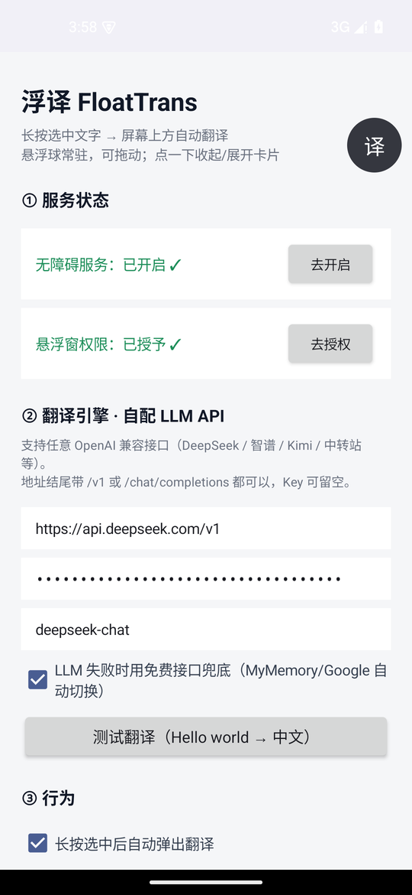
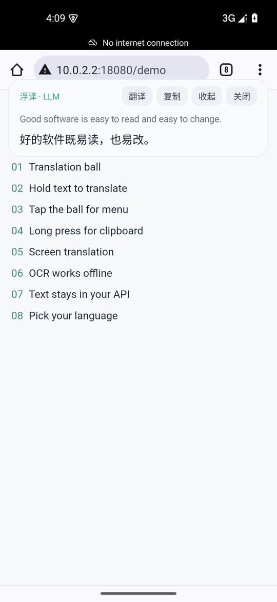
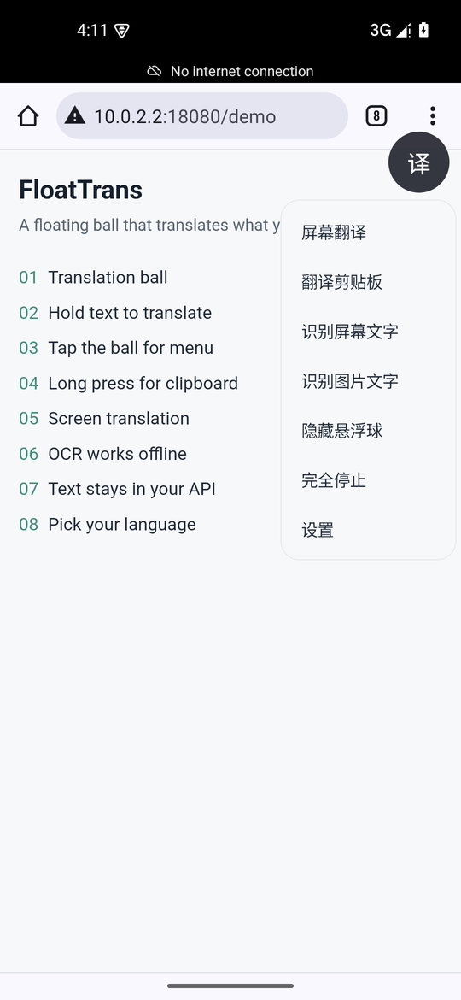
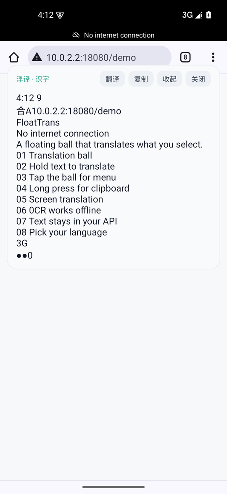
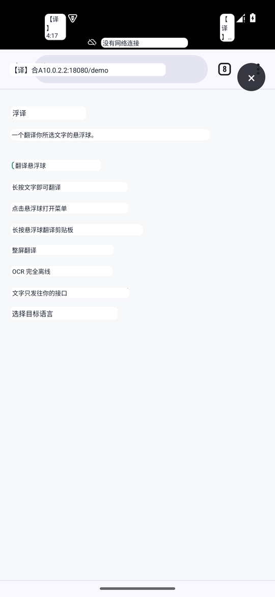

# 浮译 FloatTrans

一个「常驻悬浮球」的划词 / 识屏翻译工具，Android 应用。

翻译引擎使用**你自己配置的 OpenAI 兼容 LLM**（DeepSeek / 智谱 / Kimi / 本地 Ollama / 各类中转站均可），失败时自动回落到免 key 的免费接口。无账号、无统计、不收集任何数据。

<p>
  
  
  
</p>
<p>
  
  
</p>

## 功能

| 功能 | 说明 |
| --- | --- |
| 划词翻译 | 原生控件（备忘录、聊天输入框、大部分 App 正文）长按选中文字，松手后顶部自动弹出译文卡片 |
| 悬浮球菜单 | 点悬浮球弹出：屏幕翻译 / 翻译剪贴板 / 识别屏幕文字 / 识别图片文字 / 隐藏悬浮球 / 完全停止 / 设置 |
| 不挡视线 | **前台切到游戏时自动隐藏悬浮球**（按应用分类判断），离开游戏自动恢复；设置页还有总开关「在屏幕上显示悬浮球」，菜单里也可「隐藏悬浮球」「完全停止」 |
| 剪贴板翻译 | 长按悬浮球直接翻译剪贴板内容（微信、QQ 等不产生选区事件的应用的兜底方案） |
| 选中菜单「浮译」 | 注册了 `ACTION_PROCESS_TEXT`，在浏览器等应用里选中文字后从菜单里点「浮译」即可翻译 |
| 屏幕翻译 | 截屏 → 本地 OCR → 逐行批量 LLM 翻译 → **译文按原文位置覆盖全屏**，点空白或「×」关闭 |
| 识别屏幕文字 | 截屏 OCR，结果卡片可复制、可一键翻译 |
| 识别图片文字 | 从相册选图 OCR，可复制、可一键翻译 |
| 目标语言 | 简体中文 / 繁體中文 / 英语 / 日语 / 韩语 / 法语 / 德语 / 西班牙语 / 俄语 |
| 免费兜底 | LLM 失败自动切换 MyMemory / Google 免 key 接口（设置里可关） |

## 环境要求

- **Android 8.0+**（`minSdk 26`）；**屏幕翻译 / 截屏识字需要 Android 11+**（依赖 `AccessibilityService.takeScreenshot`，API 30）
- 自备一个 OpenAI 兼容 API（`/chat/completions`），地址、Key、模型名在 App 设置页填写
- 接口地址支持 `https://`，也支持 `http://`（自建 Ollama / LM Studio / one-api 等，应用已允许明文流量）

## 构建

```bash
./gradlew assembleDebug
# 产物：app/build/outputs/apk/debug/app-debug.apk
```

用 Android Studio 直接打开本目录亦可（AGP 8.7.3，Gradle 8.11.1，JDK 17+，`compileSdk 35` / `targetSdk 33`）。

- **Windows 上请把工程放在纯英文路径**：AGP 会直接拒绝包含中文等非 ASCII 字符的项目路径
- 依赖默认优先走阿里云镜像，海外环境自动回落到 `google()` / `mavenCentral()`
- 首次构建需要联网下载 ML Kit；中文 OCR 模型随包分发（离线识别），APK 约 47MB

## 使用

1. 打开 App → 授予「悬浮窗」权限、「无障碍服务」权限（Android 13+ 侧载应用可能需要在应用信息里允许「受限制的设置」）
2. 设置页填写：
   - API 地址：例如 `https://api.deepseek.com/v1`
   - API Key
   - 模型名：例如 `deepseek-chat`
   - 点「测试翻译」验证（也可以不填 LLM，只开免费兜底）
3. 手势：
   - 轻点悬浮球 → 弹出功能菜单
   - 长按悬浮球 → 翻译剪贴板
   - 拖动悬浮球 → 换位置
   - 卡片上的「翻译 / 复制 / 收起 / 关闭」按钮

> 菜单里点「完全停止」会把应用从无障碍列表里移除；下次使用需要回到设置页点「去开启」重新授权。
> 想自动维持授权，可用 `extras/magisk-guard.sh`（Magisk 开机脚本，每 60 秒检查并恢复无障碍与悬浮窗权限）。

## 已知限制

- **WebView 类应用（Chrome、夸克等）不产生系统选区事件**，划词自动弹卡仅对原生控件有效；网页场景请用「复制 → 长按悬浮球」或选中菜单里的「浮译」
- 整屏翻译对整屏文字做逐行批量请求，长屏幕大约 10~30 秒（取决于模型速度）；装饰性小字、纯数字/符号行会被跳过
- 部分模型/中转会忽略 `system` 提示词，因此本项目的翻译指令放在 user 消息内（兼容性更好）
- 截屏识字 / 整屏翻译会先收起卡片并隐藏悬浮球，等一帧再截屏，避免把自身界面识别进去
- 整屏译文按 OCR 行框覆盖原文；OCR 把一行拆成多段时，译文可能只盖住其中一段

## 隐私

- 无账号、无埋点、不收集任何数据
- 选中的文字 / OCR 结果只会发送到**你本人配置**的翻译接口
- 如果开启了「LLM 失败时用免费接口兜底」（默认开启），LLM 调用失败时文字会发给 MyMemory，再失败会发给 Google 翻译的免 key 接口；**关掉兜底即可保证文字只走你自己的接口**
- OCR（ML Kit）在本地离线完成，图片不会上传
- API Key 保存在应用私有 SharedPreferences 中，且 `allowBackup=false`，不会进入系统备份

## 目录结构

```
app/src/main/java/com/sonetto/floattrans/
├── MainActivity.java               设置页（权限引导 / 引擎配置 / 行为开关）
├── TranslateService.java           无障碍服务：选区监听、截屏、OCR、整屏翻译编排
├── FloatOverlay.java               悬浮球 + 翻译卡片 + 功能菜单
├── ScreenTranslationOverlay.java   整屏译文覆盖层（按 OCR 坐标原位覆盖）
├── ProcessTextActivity.java        选中菜单「浮译」入口
├── OcrPickActivity.java            相册识字
├── Translator.java                 引擎：LLM(OpenAI 兼容) → MyMemory → Google
└── Prefs.java                      偏好存储
extras/magisk-guard.sh              Magisk 开机守护脚本（可选，自动维持无障碍授权）
docs/screenshots/                   README 截图
```

## 更新日志

### v1.8

- 支持 `http://` 的自建翻译接口（Ollama / LM Studio / one-api 等）
- 修复截屏识字 / 整屏翻译把自身菜单和卡片一起截进 OCR 的问题
- 修复整屏译文整体下移一个状态栏、与原文错位的问题；译文块改为不透明底色
- 整屏翻译显示期间隐藏悬浮球，避免遮挡关闭按钮
- 修复「完全停止」后无法从设置页恢复悬浮球的状态问题
- 选区清空后可以再次翻译同一段文字
- 服务销毁时关闭 OCR 客户端；关于页版本号改为读取应用版本

## License

MIT
